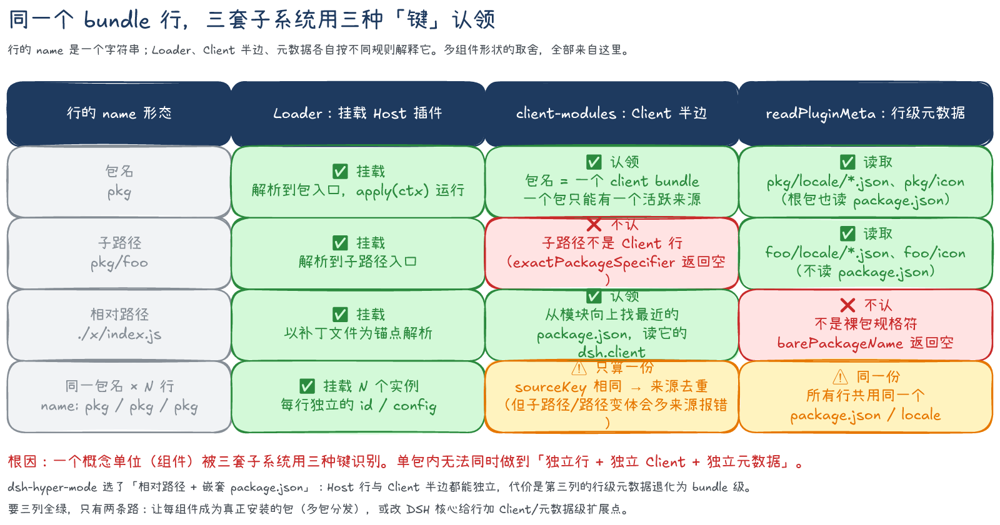

# 为什么这个模板是 monorepo

这份文档解释一个设计决定：**为什么 bundle 不能继续做成「一个包、一个 Host 入口、一个 Client 入口」，而要拆成「元包 + N 个真实 plugin 包」。**



## 一、三套身份键

DSH 里同一行会被三套子系统用三种不同的键识别。

### 1. Loader：行

`cordis.patch.yml` 里的每一行是独立的挂载单位：

```yaml
- id: echo
  name: '@scope/echo'
  config: { ... }
```

- `id` 是行的生命周期身份：启停、配置、日志；
- `name` 是模块规格符；
- Loader 解析 `name` → import → 运行模块导出的 `apply(ctx, config)`；
- 行卸载时，`apply` 里注册的东西由 Cordis 自动清理。

这一层对 `name` 最宽容：包名、子路径、相对路径、`file:` URL、`cordis:` 内置都接受。

### 2. client-modules：包

包声明 `dsh.client` 并导出 `./client`。Host 侧的 `client-modules` 扫描**活跃行**，对每一行：

1. 从行模块向上找最近的 `package.json`；
2. 读它的 `dsh.client`；
3. 把该包的 Client bundle 加进启动图。

启动图按**包名**键。浏览器里每个包只注册一个 lazy factory，Client 插件只挂一次。

两个硬约束：

- 子路径行不会被当作 Client 行（`exactPackageSpecifier` 返回空）；
- 同一个包出现两个活跃来源，`reconcilePackage` 直接抛错。

所以 **Client 的生命周期跟着包走，不跟着行走**。一个包里注册的多个 UI 组件共享同一份 Client 的加载/卸载，不能按行独立启停。

### 3. Plugin Manager：裸包规格符

`readPluginMeta` 不加载插件，只读导出资源。`barePackageName(name)` 必须能从 `name` 解析出包名：

- 根包：读 `package.json` 的 `name`/`description`/`icon`，以及 `locale/*.json`；
- 子路径：读 `<specifier>/locale/*.json` 与 `<specifier>/icon`，不读 `package.json`；
- 相对路径/URL：直接没有行级元数据。

这一层比 Client 更窄：子路径可以，相对路径不行。

## 二、三者的交集

| 行的 `name` | Loader | Client | 行级元数据 |
|---|---|---|---|
| `pkg` | ✅ | ✅ 每包一份 | ✅ |
| `pkg/sub` | ✅ | ❌ 不是 Client 行 | ✅ |
| `./x/index.js` | ✅ | ✅ 最近 `package.json` | ❌ |
| `pkg` × N 行 | ✅ N 个实例 | ⚠️ 去重成一份 | ⚠️ 同一份 |

一句话：**Loader 什么都认；Client 只认包；元数据只认裸包名。**

一个组件想同时拥有「独立行 + 独立 Client + 独立元数据」，就必须在三个系统里都是同一个真实包。单包内的任何做法都至少牺牲一列。

## 三、hyper-mode 的妥协

`dsh-hyper-mode` 要 N 个独立面板，每个面板跟自己的 Host 行同生共死；它又是单包分发。于是用「相对路径行 + 嵌套 `package.json`」造伪包：

- 行 `./plugins/hyper-roles/index.js` 是路径式；
- `client-modules` 从模块向上找，找到 `plugins/hyper-roles/package.json`，这个 Client 只属于这一行；
- 根包不声明 `dsh.client`，避开「同一包多来源」。

代价是行级元数据：路径式行不是裸包规格符，`readPluginMeta` 放弃它，Plugin Manager 里这一行没有独立标题/图标/详情，元数据只剩 bundle 级。

这不是野路子——`locatePkgJson → nearestPackage` 就是为路径式行设计的。但它让**包边界同时承担安装单位、Client 身份、元数据身份**三件事。代码干净，身份模型妥协。

## 四、DSH 自己的「全绿」形状

`@deepseek-ai/dsh-web-app` 是元包：自己声明 bundle，依赖 145 个包；patch 里按裸包名插入 `@deepseek-ai/dsh-client-ui-*` 行。每个 UI 包有自己的 `dsh.client`、locale、icon、Client 入口。

于是行 = 包 = Client = 元数据，三套身份在真实包上对齐。每行元数据、每组件独立 UI 全部成立。

代价是分发：N 个包、版本管理。单 tarball 要么发布所有组件包，要么用 `bundledDependencies`（需要安装路径实验验证）。

## 五、四种形状

| 形状 | 包 | 行 | Client | 行级元数据 | 独立启停/UI | 复杂度 |
|---|---|---|---|---|---|---|
| A 单包单行 + 单 client | 1 | 1 | 1 | ✅ | ❌ 共享生命周期 | 最低 |
| B 单包多行 + 单 client | 1 | N | 1 | ✅ | Host ✅ / UI ❌ | 低 |
| C 单包嵌套伪包（hyper-mode） | 1（含伪包） | N | N | ❌ bundle 级 | ✅ | 中 |
| D 元包 + 真组件包（dsh-web-app） | N+1 | N | N | ✅ | ✅ | 高 |

本模板选 **D**：每组件一个独立行、独立 Client、独立元数据，代价是 N 个包的分发与版本管理。

## 六、选 D 之后的硬规则

1. **元包不挂 Host、不声明 `dsh.client`。** 它只有 patch、bundle 级 locale/icon/docs，以及 `workspace:*` 依赖。
2. **每个 plugin 是一个真实包，行名用裸包根。** 这是三套身份同时成立的交集。
3. **一个带 UI 的组件一个包。** 一个包只能有一个活跃 Client 来源，多个 UI 面板塞进同一个包会让它们的生命周期绑死。
4. **plugin 包导出 `./locale/*.json`、`./icon`、`./package.json`。** 行级元数据靠这三个导出读取。
5. **`@deepseek-ai/*` 三件套：peer + dev + external。** peer 让 profile resolver 把裸请求路由到安装副本，dev 服务构建，external 保证运行时仍有裸请求。
6. **Client 半边只 `import type`。** 浏览器模块表不认 `@deepseek-ai/*` 的运行时 import。
7. **N=1 与 N=10 同构。** 元包不需要为新插件写代码；加包 = 加目录 + 加依赖 + 加一行 patch。

## 七、本地 link 的边界

`dsh plugin add` 对本地目录用 `link:`。`file:` 不行：`workspace:*` 只在 workspace 内解析，消费者上下文会报 `ERR_PNPM_WORKSPACE_PKG_NOT_FOUND`。

link 能验「组合」：行挂上、Client 加载、config 生效。

link 不一定能验「实例共享」：只 link 元包时，plugin 包的真实路径在元包之外，profile resolver 的 linked-root 判定可能不覆盖它们；这些模块的静态 import 会走 Node 原生解析，落到 workspace 的 devDependencies 副本。要验实例共享，需要把 plugin 包也做成顶层 link，或走 pack 后的 release-like 安装。

## 八、没有契约检查时，模板靠什么保证正确

当前模板内置 `typecheck` + `build` + `pack:check`：

- `typecheck` 保证源码与 DSH 类型契约一致；
- `build` 保证 Host/Client 半边产出正确形状；
- `pack:check` 保证 `files` 没有漏项、`src/` 没有漏进 tarball。

契约检查（逐行校验 patch、config、Client 注册 id、slot 唯一性）可以作为后续一层加在 `scripts/` 里；它需要读 `cordis.patch.yml`，届时再引入 YAML 解析依赖。
